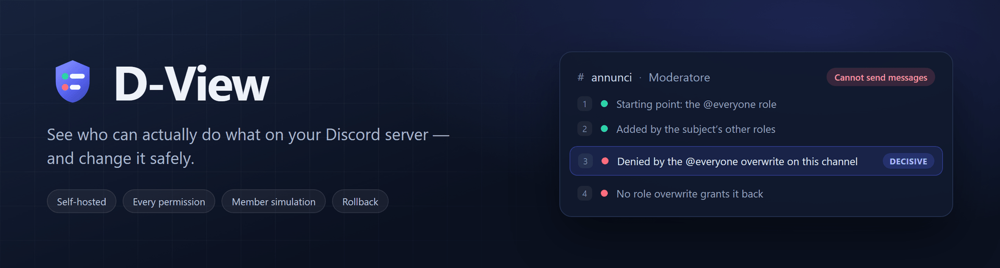

<div align="center">




[Quick start](#quick-start) · [Features](#features) · [Safety](#safety) · [Operations](docs/self-hosting.md) · [Development](docs/self-hosting.md#native-development) · [AI agents](docs/agent-workflow.md)

</div>

# D-View

A self-hosted Discord permission dashboard for server owners and administrators.
Run your own application and bot; sign in through Discord OAuth. There is no
hosted D-View service. Your instance stores server data in your PostgreSQL database
and communicates with Discord. See [Privacy](PRIVACY.md).

## Features

- **Explorer:** resolve role/member permissions and show the ordered explanation.
- **Matrix and audits:** see role-by-channel access and risky configurations.
- **Members:** individual lookup; optional full member sync.
- **History:** snapshots, comparisons, export and validated import into a plan.
- **Changes:** review masked permission edits, apply with confirmation, inspect
  per-operation results, and generate a reviewed rollback plan.
- **Languages:** English, Italiano, Deutsch, Français, Español, 中文 and Русский.

Category overwrites are not an extra inheritance layer: Discord copies them onto
synced children. Role allows/denies are aggregated, not applied in role order.
The [permission engine](docs/permission-engine.md) runs locally in the browser
and server; it is not an LLM.

## Quick start

**Requirements:** Git, Docker Engine with Linux containers (24+ recommended) and
Docker Compose v2.20+ supporting healthy/completed dependencies. Docker Desktop
works on Windows/macOS. Host Node.js and pnpm are **not required** for Compose.
The first build downloads images and npm packages; normal use needs Discord access.

### 1. Download and configure

```bash
git clone https://github.com/PrimeBuild-pc/D-View.git
cd D-View
cp .env.example .env
```

On PowerShell use `Copy-Item .env.example .env`. Edit **the root `.env`** locally:

| Variable                | Set it to                                                                                                      |
| ----------------------- | -------------------------------------------------------------------------------------------------------------- |
| `APP_URL`               | `http://localhost:3000` for local use. For a remote instance, your canonical **HTTPS** origin, without a path. |
| `AUTH_SECRET`           | A fresh random secret of at least 32 characters.                                                               |
| `POSTGRES_PASSWORD`     | A separate random **hexadecimal** password for a new database.                                                 |
| `DISCORD_CLIENT_ID`     | Application/client ID from the Developer Portal.                                                               |
| `DISCORD_CLIENT_SECRET` | OAuth2 client secret.                                                                                          |
| `DISCORD_BOT_TOKEN`     | Bot token.                                                                                                     |

Generate each secret separately with `openssl rand -hex 32`, or with a trusted
local password generator (64 hex characters). Keep them out of chat, screenshots,
logs and version control. Leave `DISCORD_WRITES_LOCKED=true` for read-only use.
Compose constructs `DATABASE_URL` internally; do not set it for this install.
**Already have a database volume?** Follow [existing installations](docs/self-hosting.md#existing-installations) before starting.

### 2. Set up Discord

1. Open the [Discord Developer Portal](https://discord.com/developers/applications)
   → **New Application**. Optional app icon: [`assets/icon.png`](assets/icon.png).
2. Under **OAuth2**, copy the **Client ID** and **Client Secret** into `.env`.
3. Under **OAuth2 → Redirects**, add exactly
   `http://localhost:3000/api/auth/callback`, or your `APP_URL` plus
   `/api/auth/callback`. Save changes. Dashboard login uses `identify` and `guilds`;
   it does not require additional user OAuth scopes.
4. Under **Bot**, create/reset the bot token and enter it in `.env`.
5. Under **Installation** (or **OAuth2 → URL Generator**), select **Guild Install**
   and the `bot` scope. For read-only use, invite with **no management permissions**
   (`permissions=0`); give **View Channels** only where channel visibility is needed.
   Do **not** grant Administrator, Manage Roles or Manage Channels for read-only use.
   Invite to your server with an account allowed to manage/install apps.
6. Optional: **Bot → Privileged Gateway Intents → Server Members Intent** is needed
   only for the full member list. Single-member lookup works without it.
   Message Content and Presence intents are not needed; there is no Gateway worker.

The `/setup` page also offers a read-only invite link with no management
permissions. See [optional writes](docs/self-hosting.md#optional-discord-writes)
before deliberately granting management permissions.

### 3. Start the whole application

```bash
docker compose up -d --build
docker compose ps -a
docker compose logs --tail=100 schema web
```

Compose starts PostgreSQL, waits for database readiness, runs a **one-shot schema
job**, then starts the non-root web server. `schema` should exit with code **0**;
if it fails, web does not start. The database uses the persistent `postgres_data`
volume and has **no published host port**. Web binds only to **127.0.0.1:3000**.

Open **<http://localhost:3000/setup>**, then sign in with Discord. Only guild owners
or users with Administrator can access a server. Database connectivity and bot
validity are checked **after login**; anonymous diagnostics only show configuration.
Choose your server → **Sync now** → **Explorer**. Sync reads Discord and writes its
cache/snapshot to your local database; it does not mutate Discord permissions.

Use the exact `APP_URL` hostname: `localhost` and `127.0.0.1` are different origins.
For remote hosting, see [HTTPS and reverse proxies](docs/self-hosting.md#https-and-remote-access).

## Safety

This installation locks Discord writes in configuration. If you deliberately
remove that lock, per-server Settings can grant a 60-minute unlock (default) or
persistent unlock. `DISCORD_WRITES_ALWAYS=true` bypasses that unlock mechanism;
it is **not recommended**. `DISCORD_WRITES_LOCKED=true` takes precedence.

Plans are rebuilt server-side, authorization is checked against Discord, and
writes re-read live state and preserve untouched permission bits. Drift is skipped;
uncertain results are recorded and verified instead of blindly retried. Rollback
creates a **new plan**, not a blind restore. Discord writes are not atomic, so
inspect every result and test on a disposable role/channel, never `@everyone`.
See the [security model](docs/security-model.md).

## Container images

After successful checks on `main`, CI publishes Linux AMD64 images to GHCR.
Maintainers can also run **Actions → CI → Run workflow → main** to retry a
publication; it reruns the same checks before building and pushing images:

- Web: `ghcr.io/primebuild-pc/d-view:latest`
- Schema job: `ghcr.io/primebuild-pc/d-view-schema:latest`

Both also have a tag containing the full commit SHA. Use the same commit tag for
both images when pinning a deployment. The schema image is a one-shot database
upgrade job, not another web server. Publication does **not** start containers or
connect to Discord. The Compose quick start above still builds the local checkout.

## Operations and development

- [Configuration, native development and troubleshooting](docs/self-hosting.md)
- [Updates, backups, restores and schema changes](docs/self-hosting.md#updates-and-schema-changes)
- [Authenticated AI-agent workflow](docs/agent-workflow.md) · [Repository agent rules](AGENTS.md)
- [Architecture](docs/architecture.md) · [Implementation status](docs/implementation-plan.md)

Native development uses **Node.js 24 LTS** (or Node >=22.13; pnpm 11 and the locked
tooling need more than an early Node 22 release) and **pnpm 11.9.0**, pinned in
`package.json`. Run from the repository root; the root `dev`, `build`, `start`,
`db:push` and `db:generate` scripts load root `.env`, respecting existing environment
overrides. `DPD_ENV_FILE` selects a different env file. Direct package commands
bypass that root loader; follow the [native guide](docs/self-hosting.md#native-development).

Verification (with dependencies installed, using fake environment in an isolated
copy when credentials exist):

```bash
pnpm test
pnpm typecheck
pnpm lint
pnpm build
node --test tests/infra.test.mjs
```

## Limits and costs

- Software is MIT licensed. You pay for your own machine/VPS, disk, backups,
  electricity and, if applicable, domain/TLS hosting. There is **no runtime LLM,
  AI API charge, model download or bundled AI agent**. External coding agents may
  have their own subscription/API costs. No hosted-free-tier promise is made.
- Sync is manual; snapshots/history have no automatic retention cleanup.
- Discord REST availability, rate limits and role hierarchy apply. Large plans
  use conservative spacing, not full per-bucket scheduling.
- No role/channel creation, deletion or reordering. Import cannot migrate legacy
  name-based permission snapshots; re-sync for bitfield-format snapshots.
- Browser end-to-end coverage is not yet provided; current automated checks cover
  engine, API/security, UI rendering/accessibility and tooling behavior.

## Support

[Support development](https://paypal.me/PrimeBuildOfficial?country.x=IT&locale.x=it_IT)

[Security policy](SECURITY.md) · [Terms](TERMS.md) · [Privacy](PRIVACY.md) · [MIT license](LICENSE)
